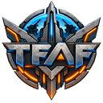

  

<h1 align="center">TFAF</h1>

  An unofficial <a href="https://www.faforever.com">Forged Alliance Forever</a> client for Supreme Commander: Forged Alliance

  <b>English</b> · <a href="README.ru.md">Русский</a>

  
  
  
  

  <a href="https://github.com/tergride/tfaf/releases/latest"><b>Download the latest version</b></a>
  &nbsp;·&nbsp;
  <a href="https://github.com/tergride/tfaf/releases">All versions</a>
  &nbsp;·&nbsp;
  <a href="https://github.com/tergride/tfaf/issues">Report a problem</a>

---

TFAF is an unofficial client for Forged Alliance Forever, an alternative to the official FAF client. It signs in with your FAF account and connects to the same servers, so you play together with everyone on FAF, whichever client they use.

## Features

- Custom games, co-op campaigns and missions, and the matchmaker with parties.
- The TFAF lobby (experimental): a game room right in the launcher, with start positions on the map, chat and AI. Only TFAF players can join it. Besides FAF it plays FAF Beta Balance, FAF Develop and Nomads.
- Before a game the launcher checks the game files, the map and the mods against the FAF vault and against the host. The Current game tab shows the connection, ping, packet loss and files of every player.
- Its own network adapter without Java, compatible with players of the official client.
- FAF chat with channels, private messages and your clan channel, a friends list in the title bar and game invites for friends (experimental). TFAF players see each other by a badge next to their name.
- The map and mod vault: search, install, reviews, uploading your own, and the Neroxis map generator. Map overview draws a map from its own files, with relief, textures and props.
- Replays from the FAF vault and from files, live games to watch. Replay files can be opened in TFAF from Explorer.
- All settings of the game itself and its hotkeys, with the Default, Hotbuild and Alternative layouts, and their export and import to a file.
- Player profiles with ratings and achievements, leaderboards, tournaments, news, and the Spooky DB and FAF Unit DB unit databases, which work offline.
- Notifications with sounds, a tray icon, a Discord status that friends can join a game from (experimental).
- Faction colour themes and a theme of your own, interface scale from 80 to 150 %, English and Russian.

## Installation

You need Windows 10 or 11 (64-bit), Supreme Commander: Forged Alliance (Steam or GOG) and an account on [faforever.com](https://www.faforever.com).

1. Download `TFAF-Setup-<version>.exe` from the [latest release](https://github.com/tergride/tfaf/releases/latest) and run it.
2. The installer is not signed, so Windows SmartScreen warns about an unknown publisher. Click "More info", then "Run anyway".
3. Choose the installation type:
   - **Standard installation**: for the current user without administrator rights (by default in `%LOCALAPPDATA%\Programs\TFAF`) or for all users of the computer (in `%ProgramFiles%\TFAF`, asks for administrator rights). It creates a desktop shortcut and updates itself.
   - **Portable**: TFAF keeps its settings, FAF files, maps and mods in its own folder, without registering in Windows or creating shortcuts. Such a copy can be moved to another computer; there you may have to sign in again.
4. Sign in to your FAF account: the sign-in happens on the FAF page in your browser.

TFAF can live next to the official client. With a standard installation they share maps and mods. TFAF takes the game settings and hotkeys from the official client once and keeps its own afterwards. TFAF stores the FAF game files in its own folder, `C:\ProgramData\TFAF` by default.

## Updates

A standard installation checks for updates at startup and every 4 hours, downloads a new version by itself and installs it when you restart or exit the launcher, never during a game. On the About page you can check for updates by hand and read what changed in every version. The Get beta versions box there also brings beta versions, which come out before regular ones.

- A portable copy updates by hand: run the new installer, choose Portable and the same folder.
- Versions before 0.7.0 do not update themselves. Install the latest version over them once: your settings and sign-in are kept.

## Troubleshooting

Logs help to find out what happened. Attach them when you [report a problem](https://github.com/tergride/tfaf/issues):

| What | Where |
|---|---|
| Launcher log | `%APPDATA%\tfaf-launcher\logs\launcher.log` |
| Game and network adapter logs | `C:\ProgramData\TFAF\logs` |

Both folders open from the menu under your name: Open folder → Launcher logs or Game logs. A portable copy keeps them in `portable-data` next to `TFAF.exe`.

## Uninstalling

Remove TFAF in Settings → Apps. The settings in `%APPDATA%\tfaf-launcher` and the FAF files in `C:\ProgramData\TFAF` stay; you can delete them by hand. A portable copy is removed together with its folder.

## This repository

The launcher's source code and its releases. The code is published from version 1.0.0 on; releases before it are marked as outdated, and their source code archives hold only a description. Every release contains:

| File | What for |
|---|---|
| `TFAF-Setup-<version>.exe` | The installer. |
| `TFAF-Setup-<version>.exe.blockmap` | The block map: an update downloads only the parts that changed. |
| `latest.yml` | The version description for automatic updates. |

Releases before 0.7.0 contain only the installer.

## Rules and license

The [FAF rules](https://www.faforever.com/rules) apply on the FAF servers. TFAF does not modify the installed game and gives no in-game advantage.

TFAF is not affiliated with the Forged Alliance Forever team. Supreme Commander: Forged Alliance belongs to its rights holders.

TFAF's code is under the GNU General Public License, version 3 or any later version, see [LICENSE](LICENSE). Assets from other projects and their licenses are listed in [THIRD_PARTY_NOTICES.md](THIRD_PARTY_NOTICES.md).
