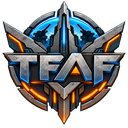

  

<h1 align="center">TFAF</h1>

  Неофициальный клиент <a href="https://www.faforever.com">Forged Alliance Forever</a> для Supreme Commander: Forged Alliance

  <a href="README.md">English</a> · <b>Русский</b>

  
  
  
  

  <a href="https://github.com/tergride/tfaf/releases/latest"><b>Скачать последнюю версию</b></a>
  &nbsp;·&nbsp;
  <a href="https://github.com/tergride/tfaf/releases">Все версии</a>
  &nbsp;·&nbsp;
  <a href="https://github.com/tergride/tfaf/issues">Сообщить о проблеме</a>

---

TFAF — неофициальный клиент Forged Alliance Forever, альтернатива официальному клиенту FAF. Он работает с вашим аккаунтом FAF и подключается к тем же серверам, поэтому вы играете вместе со всеми игроками FAF, в каком бы клиенте они ни сидели.

## Возможности

- Произвольные игры, кампании и миссии кооператива, матчмейкер с группами.
- Лобби TFAF (экспериментальный режим): комната игры прямо в лаунчере, со стартовыми позициями на карте, чатом и AI. Зайти в неё могут только игроки TFAF. Кроме FAF, в ней можно играть в FAF Beta Balance, FAF Develop и Nomads.
- Перед игрой лаунчер сверяет файлы игры, карту и моды с хранилищем FAF и с хостом. Вкладка «Текущая игра» показывает связь, пинг, потери и файлы каждого игрока.
- Свой сетевой адаптер без Java, совместимый с игроками официального клиента.
- Чат FAF с каналами, личными сообщениями и каналом клана, список друзей в заголовке окна и приглашения друзей в игру (экспериментально). Игроки TFAF видят друг друга по значку у ника.
- Хранилище карт и модов: поиск, установка, отзывы, загрузка своих и генератор карт Neroxis. «Обзор карты» рисует карту из её файлов, с рельефом, текстурами и объектами.
- Реплеи из хранилища FAF и из файлов, просмотр идущих игр. Файлы реплеев можно открыть в TFAF из Проводника.
- Все настройки самой игры и её клавиши с раскладками «Стандартная», «Hotbuild» и «Альтернативная», экспорт и импорт в файл.
- Профили игроков с рейтингами и достижениями, таблицы лидеров, турниры, новости и базы юнитов Spooky DB и FAF Unit DB, которые работают без связи.
- Уведомления со звуками, значок в области уведомлений, статус в Discord, из которого друзья могут зайти в игру (экспериментально).
- Темы в цветах фракций и своя тема, масштаб интерфейса от 80 до 150 %, русский и английский языки.

## Установка

Нужны Windows 10 или 11 (64 бита), установленная Supreme Commander: Forged Alliance (Steam или GOG) и аккаунт на [faforever.com](https://www.faforever.com).

1. Скачайте `TFAF-Setup-<версия>.exe` из [последнего релиза](https://github.com/tergride/tfaf/releases/latest) и запустите его.
2. Установщик не подписан, поэтому Windows SmartScreen предупредит о неизвестном издателе. Нажмите «Подробнее», затем «Выполнить в любом случае».
3. Выберите тип установки:
   - **Обычная установка**: для текущего пользователя без прав администратора (по умолчанию в `%LOCALAPPDATA%\Programs\TFAF`) или для всех пользователей компьютера (в `%ProgramFiles%\TFAF`, с запросом прав администратора). Она создаёт ярлык на рабочем столе и обновляется сама.
   - **Portable**: TFAF хранит настройки, файлы FAF, карты и моды в своей папке, без регистрации в Windows и ярлыков. Такую копию можно перенести на другой компьютер, там может понадобиться войти заново.
4. Войдите в аккаунт FAF: вход проходит на странице FAF в браузере.

TFAF можно держать рядом с официальным клиентом. При обычной установке карты и моды у них общие. Настройки игры и клавиши TFAF один раз берёт у официального клиента, а дальше хранит свои. Файлы игры FAF TFAF держит в своей папке, по умолчанию `C:\ProgramData\TFAF`.

## Обновления

Обычная установка проверяет обновления при запуске и раз в 4 часа, сама скачивает новую версию и ставит её при перезапуске или выходе из лаунчера, но не во время игры. В разделе «О программе» можно проверить обновления вручную и прочитать, что изменилось в каждой версии. Там же галочка «Получать бета-версии»: с ней приходят и бета-версии, которые выходят раньше обычных.

- Portable-копия обновляется вручную: запустите новый установщик, выберите Portable и ту же папку.
- Версии до 0.7.0 сами не обновляются. Поставьте последнюю версию поверх них один раз: настройки и вход сохранятся.

## Если что-то не работает

Логи помогают понять, что случилось. Приложите их, когда [сообщаете о проблеме](https://github.com/tergride/tfaf/issues):

| Что | Где |
|---|---|
| Лог лаунчера | `%APPDATA%\tfaf-launcher\logs\launcher.log` |
| Логи игр и сетевого адаптера | `C:\ProgramData\TFAF\logs` |

Обе папки открываются из меню под ником: «Открыть папку» → «Логи лаунчера» или «Логи игр». У portable-копии они лежат в `portable-data` рядом с `TFAF.exe`.

## Удаление

Удалите TFAF в «Параметры» → «Приложения». Настройки в `%APPDATA%\tfaf-launcher` и файлы FAF в `C:\ProgramData\TFAF` остаются, их можно удалить вручную. Portable-копия удаляется вместе со своей папкой.

## Что в этом репозитории

Исходный код лаунчера и его релизы. Код опубликован начиная с версии 1.0.0: релизы до неё помечены как устаревшие, а их архивы исходников содержат только описание. В каждом релизе:

| Файл | Зачем |
|---|---|
| `TFAF-Setup-<версия>.exe` | Установщик. |
| `TFAF-Setup-<версия>.exe.blockmap` | Карта блоков: при обновлении лаунчер скачивает только изменившиеся части. |
| `latest.yml` | Описание версии для автообновления. |

Релизы до 0.7.0 содержат только установщик.

## Правила и лицензия

На серверах FAF действуют [правила FAF](https://www.faforever.com/rules). TFAF не правит файлы установленной игры и не даёт преимуществ в игре.

TFAF не связан с командой Forged Alliance Forever. Supreme Commander: Forged Alliance принадлежит её правообладателям.

Код TFAF распространяется по лицензии GNU GPL версии 3 или любой более поздней версии, см. [LICENSE](LICENSE). Ресурсы из других проектов и их лицензии перечислены в [THIRD_PARTY_NOTICES.md](THIRD_PARTY_NOTICES.md).
